<p align="center">
  
</p>

# 🩺 Neuro-Log — Prontuário eletrônico para médicos autônomos

SaaS de prontuário eletrônico com **teleconsulta, receita digital e assinatura ICP-Brasil**, em produção e com médicos assinantes.

🔗 **Site:** https://neurolog.med.br/

> **Sobre este repositório:** aqui está o código da **landing page** e um **estudo de caso** do produto.
> O sistema (back-end e front-end) é **comercial e fica em repositórios privados**, porque lida com dados de saúde de pacientes reais.


---

## O problema

Médicos que atendem por conta própria precisam de um prontuário que siga a **Resolução CFM 2.454/2026** e a **LGPD**, com teleconsulta e receita digital. Os sistemas do mercado são feitos para clínicas grandes, com preço e complexidade de clínica grande.

## A solução

Um prontuário enxuto, feito para um médico só, que cobre o atendimento de ponta a ponta: **agenda → consulta (presencial ou on-line) → prontuário estruturado → receita assinada digitalmente**.

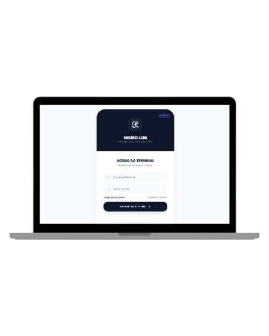

---

## Funcionalidades

### 👨‍⚕️ Cadastro e acesso do médico
- **Validação do CRM na base pública do CFM** no cadastro, com aprovação do administrador
- Suporte a **mais de um CRM** por médico (atuação em mais de um estado) e RQE
- Verificação por **e-mail e SMS**, recuperação de senha e período de teste com assinatura

### 📅 Agenda e prontuário
- **Agenda semanal** com status de consulta unificados (agendada, em atendimento, concluída...)
- **Prontuário com campos clínicos estruturados**: anamnese, exame físico, hipóteses diagnósticas
- Prontuário **travado após a conclusão**, como exige a norma, sem edição retroativa
- Histórico completo do paciente e painel com indicadores do consultório

### 🎥 Teleconsulta (WebRTC)
- Videochamada direto no navegador, **sem instalar nada**, para médico e paciente
- **Sala de espera** com link de acesso por **token aleatório** (não dá para adivinhar o link de outra consulta)
- **Termo de consentimento** do paciente antes de entrar
- Sinalização em tempo real via **Pusher** e servidores **TURN da Cloudflare**, para a chamada funcionar até atrás de redes restritas

### 💊 Receita e documentos
- Receituário integrado à **Memed** e fluxo próprio de receita
- **Assinatura digital ICP-Brasil (PAdES)** com o certificado A1 do médico, com carimbo visual e validação em `validar.iti.gov.br`

### 🤖 Apoio de IA com anonimização
- Análise de caso clínico com IA (Gemini) **somente com consentimento**
- O texto é **anonimizado antes de sair do servidor**: nomes, CPF e outros identificadores são removidos
- **Log de auditoria** de cada uso, para comprovar a conformidade

### 🔌 API de teleconsulta para parceiros
O módulo de vídeo também funciona **como produto separado**: outros sistemas de saúde podem criar salas de teleconsulta pelo Neuro-Log.
- API REST versionada (`/v1/rooms`) protegida por **API key**
- **Idempotência**: repetir a criação da sala com o mesmo `external_id` devolve a mesma sala
- Links separados para médico (host) e paciente (guest), com **expiração automática**
- **Webhooks assinados com HMAC-SHA256** para avisar o parceiro sobre eventos (consentimento respondido, transcrição pronta)

---

## Segurança e conformidade

| Tema | O que foi feito |
|---|---|
| Isolamento de dados | Cada médico só acessa os próprios pacientes, consultas e receitas |
| Certificado digital | O arquivo `.pfx` e a senha ficam **criptografados no banco**; o certificado é validado e a data de vencimento é conferida antes de assinar |
| Força bruta | Limite de tentativas no login, no reenvio de e-mail e nos links públicos de consulta |
| Links de consulta | Token aleatório no lugar do ID sequencial |
| Dados enviados para IA | Anonimização antes do envio + consentimento + log de auditoria |
| Auditoria | Revisão de segurança em seis frentes: rate limiting, CORS, exposição de dados pessoais (PII), clickjacking, entre outras |
| Testes | Testes automatizados de segurança, de receitas e do fluxo de status das consultas (PHPUnit) |

---

## Arquitetura

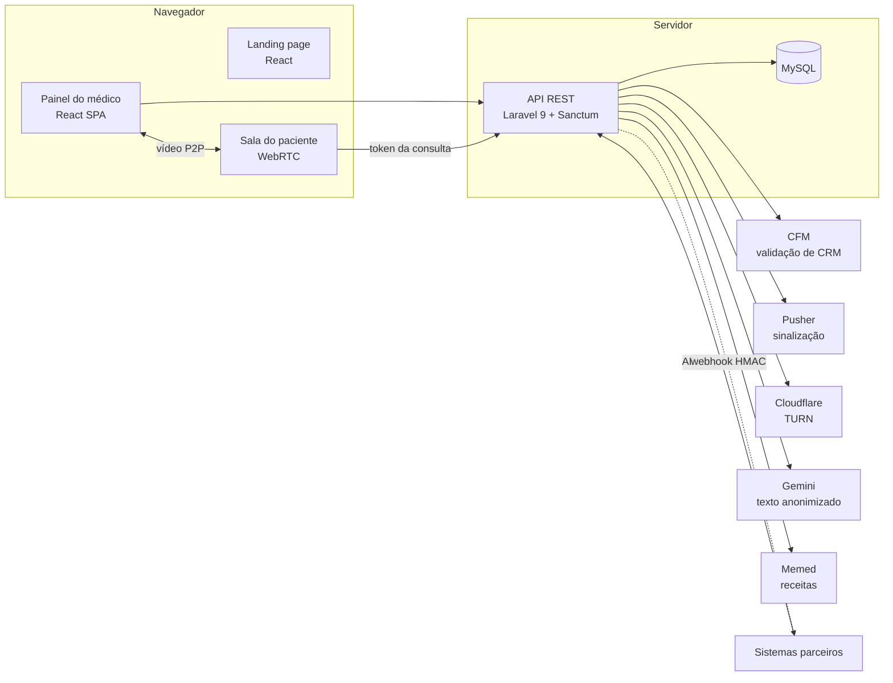

## Stack

| Camada | Tecnologia |
|---|---|
| Back-end | Laravel 9, PHP 8, Laravel Sanctum, MySQL |
| Front-end | React 19, Vite 7, TailwindCSS 4, Lucide Icons |
| Tempo real e vídeo | WebRTC, Pusher, Cloudflare Realtime (TURN) |
| Documentos | TCPDF + FPDI (assinatura PAdES), jsPDF, pdf-lib |
| Integrações | CFM, Memed, Google Gemini, SMS, Discord (alertas internos) |
| Landing page | React + Vite + TailwindCSS, Google Tag Manager |

---

## Capturas de tela

> Todas as telas usam **pacientes de teste**; telefones e CPFs foram borrados.

**Agenda:** visão por dia, semana ou mês, com busca de paciente e impressão
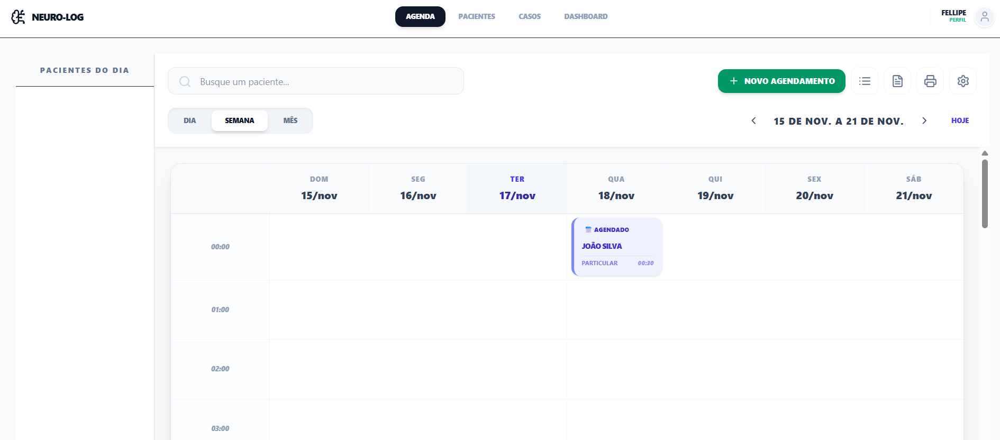

**Dashboard:** agendamentos, consultas realizadas, faltas, cancelamentos, faturamento e perfil dos atendimentos por período
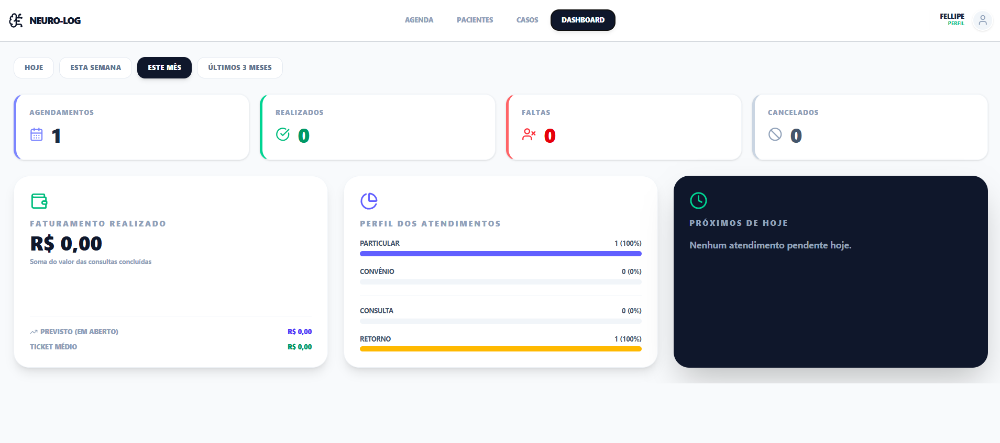

**Prontuário estruturado:** anamnese, exame físico, testes e escalas, hipóteses (CID-10) e conduta, com atalhos para Análise IA, Prescrição Inteligente e Atendimento Online
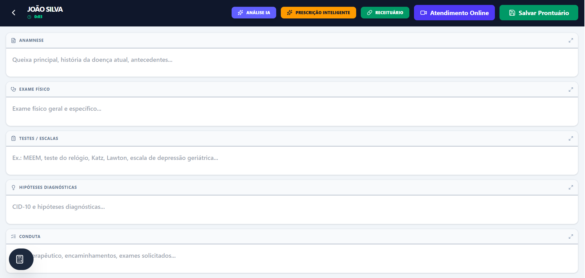

**Teleconsulta:** prontuário e vídeo lado a lado, aguardando o consentimento do paciente
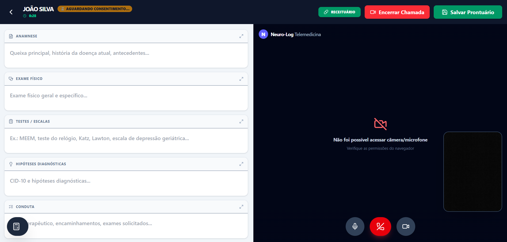

**Receituário digital:** receita simples, controle especial, azul/amarela (Memed) e exames, com envio por WhatsApp e PDF assinado ICP-Brasil
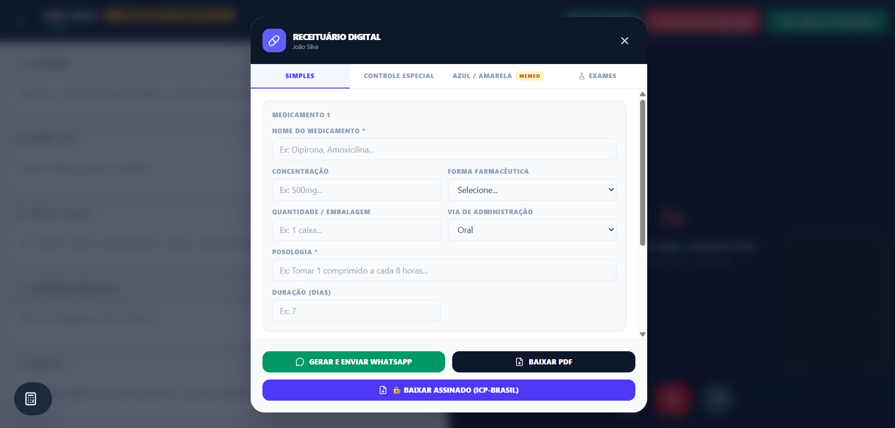

**Integração Memed:** prescrição dentro do Neuro-Log, já com o paciente preenchido
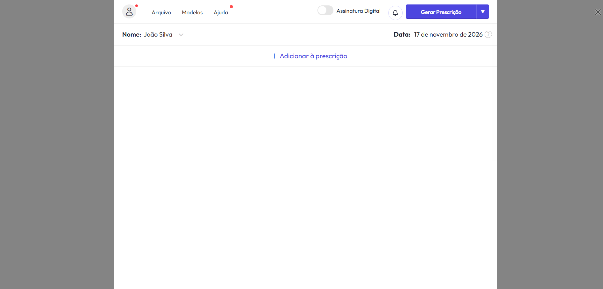

**Pacientes:** busca por nome, CPF ou número do prontuário
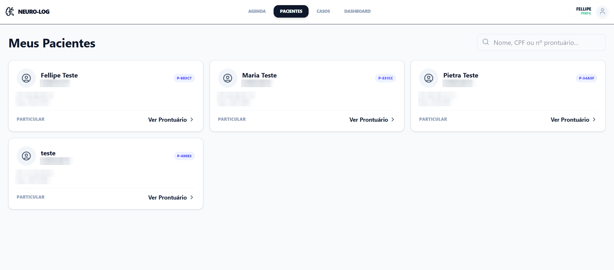
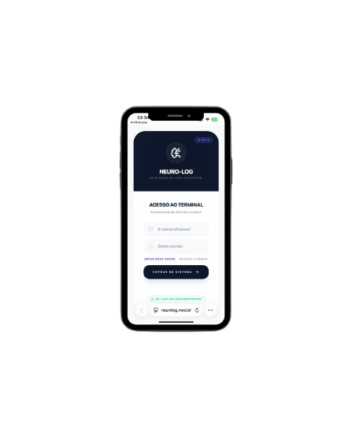

🎬 [Vídeo de demonstração](public/assets/demo-C21IEXB2.mp4)

---

## Rodar a landing page

```bash
npm install
npm run dev
```

## Autor

**Fellipe Zapelini**, fundador e desenvolvedor · [LinkedIn](https://www.linkedin.com/in/fellipe-zapelini-080a24288/) · [GitHub](https://github.com/fellipezapelini)

---

© Fellipe Zapelini. Todos os direitos reservados. Neuro-Log é um produto comercial; este repositório é publicado apenas como portfólio.
